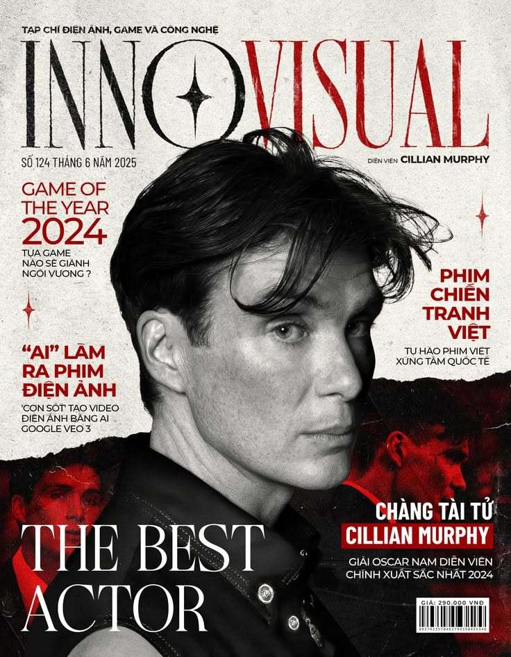
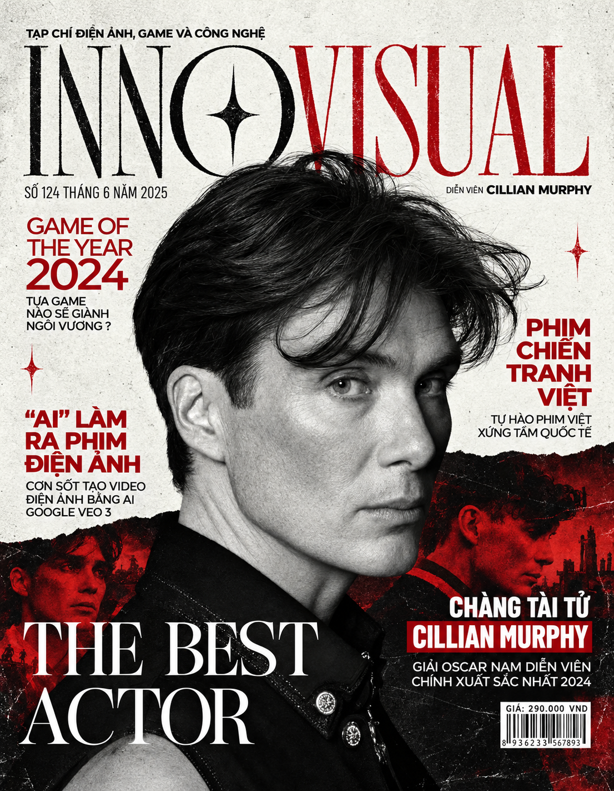

# image-prompt-reverse · 图片反推提示词生成器

> 上传一张图片，自动识别图片类型，按 **「0-任务目标 + 5S + 约束条件」** 结构生成可直接喂给 GPT image 2.5 的完整中文提示词，并把每条结果**独立保存为 txt**。

一个 WorkBuddy / CodeBuddy 通用 Skill。

---

## ✨ 特性

- 🖼️ **上传即用**：只需要一张图片，无需任何额外输入
- 🏷️ **自动识别类型**：人像 / 电商产品 / 海报平面 / 风景建筑 / 插画动漫 / 美食 / UI / Logo / 宠物 / 其他
- 🧩 **结构化输出**：任务目标 + 5S（Subject / Style / Shot / Setting / Scene lighting）+ 约束条件
- 🇨🇳 **完整中文提示词**：可直接投喂 GPT image 2.5，高度还原参考图
- 📄 **独立保存**：每次反推生成一个新 txt，绝不覆盖、绝不堆砌、不占上下文节省Token
- 🔒 **纯本地运行**：无网络请求、无凭据读取、无破坏性操作

## 📁 目录结构

```
image-prompt-reverse/
├── SKILL.md                        # 技能主流程
├── references/
│   ├── prompt-template.md          # 反推提示词模板（任务目标 + 5S + 约束条件）
│   └── image-type-taxonomy.md      # 图片类型识别维度 + 各类型关注重点
├── scripts/
│   └── save_prompt.py              # 唯一文件名 + UTF-8 保存 txt
├── examples/
│   └── 案例1/                       # 完整案例：电影杂志封面
│       ├── 参考图片.jpg             # 参考输入图
│       ├── 反推提示词.txt           # 反推得到的完整提示词
│       └── 反推图片.png             # 用「参考图 + 提示词」生成的成品
├── LICENSE
└── README.md
```

## 🚀 安装

将整个 `image-prompt-reverse/` 目录放入技能目录：

| 范围 | 路径 |
|---|---|
| 用户级（所有项目可用） | `~/.workbuddy-ai/skills/image-prompt-reverse/` |
| 项目级（仅当前项目） | `<项目根>/.workbuddy-ai/skills/image-prompt-reverse/` |

Windows 用户级路径示例：`C:\Users\<你的用户名>\.workbuddy-ai\skills\image-prompt-reverse\`

也可以直接解压 Releases 中的 `image-prompt-reverse.zip` 到上述目录。放入后重启一次会话即可加载。

## 🎯 使用

1. 上传一张图片
2. 说「**反推提示词**」/「**复刻这张图**」/「**帮我写提示词**」
3. 得到：图片类型判定 + 保存路径 + 提示词全文

**输出目录**：当前工作区下的 `outputs/`
**文件命名**：`YYYYMMDD_HHMMSS_<图片类型>_<序号>.txt`（UTF-8，时间戳保证唯一）

## 🧱 提示词结构

| 编号 | 字段 | 说明 |
|---|---|---|
| 0 | 任务目标 | 这张图拿来做什么？视觉重点是什么？ |
| 1 | Subject 主体/核心视觉元素 | 主体外形/细节/服饰/妆造/道具/神情/姿态/站位/眼神；多主体空间关系；文案内容 |
| 2 | Style 风格 | 整体风格、主导审美、色彩语言、质感特征、是否风格融合 |
| 3 | Shot 镜头与构图 | 景别、机位角度、透视、构图、摄影参数、主体占比、虚化、视觉重心、留白、前中后景虚实 |
| 4 | Setting 场景元素与环境 | 地点、时间、天气、空间结构、前中后景元素、支撑/可省略/不可少元素、招牌标语文字 |
| 5 | Scene lighting 场景光照与影调 | 光源、方向、色温冷暖、明暗关系、轮廓光/补光/氛围光、阴影强弱与过渡 |
| 6 | 约束条件 | 必须保留什么？不要出现什么？冲突时什么优先？ |

## 🖼️ 案例

### 案例 1 · 电影杂志封面（海报 / 平面设计）

流程：**参考图 → 反推提示词 → AI 生成成品**

| 参考图片 | 反推图片（生成结果） |
|---|---|
|  |  |

- 参考图：`examples/案例1/参考图片.jpg`
- 完整提示词：`examples/案例1/反推提示词.txt`
- 生成成品：`examples/案例1/反推图片.png` —— 用「参考图 + 反推提示词」生成，高度还原原图

**反推提示词节选**（完整版见 `examples/案例1/反推提示词.txt`）：

```markdown
# 0 - 任务目标（Task Objective）
生成一张具有国际一线电影艺术杂志水准的高端越南语电影杂志封面，整体高度还原参考图的版式结构、人物肖像摄影、字体设计、色彩系统及复古印刷质感……

# 1 - Subject 主体／核心视觉元素
## 1.1 核心人物：Cillian Murphy
清瘦修长的面部比例、鲜明的颧骨、略微凹陷的面颊……采用高精度黑白电影肖像摄影质感，必须保留成年人真实皮肤的微观纹理，禁止过度磨皮、塑料皮肤、蜡像质感。
## 1.2 头发造型
浓密的深黑色中等长度头发，自然凌乱的电影感偏分发型……每一大束头发都应由大量真实细发丝构成，不出现塑料状的大块白色反射。
## 1.3 面部方向与眼神控制
三分之四侧脸构图，头部略向画面右侧转动，眼睛略微回望镜头……目光沉静、锐利、克制。

# 2 - Style 风格
高端电影文化杂志封面 + 国际编辑设计 + 复古印刷美学……严格采用黑、暖白、深红三色体系。

# 3 - Shot 镜头与构图
竖版杂志封面（约 0.78:1）；头肩近景肖像，等效焦距约 70–100mm；人物头部宽度约占画面 60%–70%；顶部刊名位于人物头发后方，由发丝自然遮挡形成层次。

# 4 - Setting 场景元素与环境
非现实环境照，而是「影棚肖像 + 电影剧照拼贴 + 杂志文字系统」合成的二维编辑封面……顶部刊名「INNOVISUAL」前半黑色、后半深红，字母 O 内含黑色四角星。

# 5 - Scene Lighting 场景光照与影调
经典低调电影肖像布光（Low-key）……主光位于面部前方偏左上侧；高对比黑白肖像，深黑 / 暖白 / 暗红，保留细腻皮肤质感与自然胶片颗粒。

# 6 - 约束条件（Hard Constraints）
必须保留：Cillian Murphy 黑白超写实肖像、发丝遮挡刊名的层次、黑/暖白/深红三色、底部「THE BEST ACTOR」白色衬线标题、右侧越南语专题模块。
严格禁止：插画/CG/3D 化、彩色化、过度磨皮、改变五官比例、乱码、多余装饰。
冲突优先级：人物身份与肖像真实性 > 整体版式 > 字体文案 > 色彩体系 > 拼贴纹理 > 次要装饰。
```

> 提示：完整提示词采用 `# 0 - 任务目标` ~ `# 6 - 约束条件` 的 Markdown 结构，每个字段下可再细分小节（如 1.1 / 1.2 / 1.3），适合需要精细控制的长提示词。

## 🛠️ 脚本用法

`scripts/save_prompt.py` 可独立使用：

```bash
# 从内容文件读取
python scripts/save_prompt.py --type "人像" --content-file prompt.txt --outdir ./outputs

# 从标准输入读取
echo "提示词内容" | python scripts/save_prompt.py --type "产品" --outdir ./outputs

# 直接传内容
python scripts/save_prompt.py --type "风景" --content "0-任务目标：..." --outdir ./outputs
```

运行后会在 stdout 打印保存文件的绝对路径。

## 📌 自定义

- **改输出结构**：编辑 `references/prompt-template.md`
- **改类型识别范围**：编辑 `references/image-type-taxonomy.md`
- **改默认输出目录**：`scripts/save_prompt.py` 中的 `DEFAULT_OUTDIR`，或运行时用 `--outdir` 指定

## 📄 License

[MIT](LICENSE)
